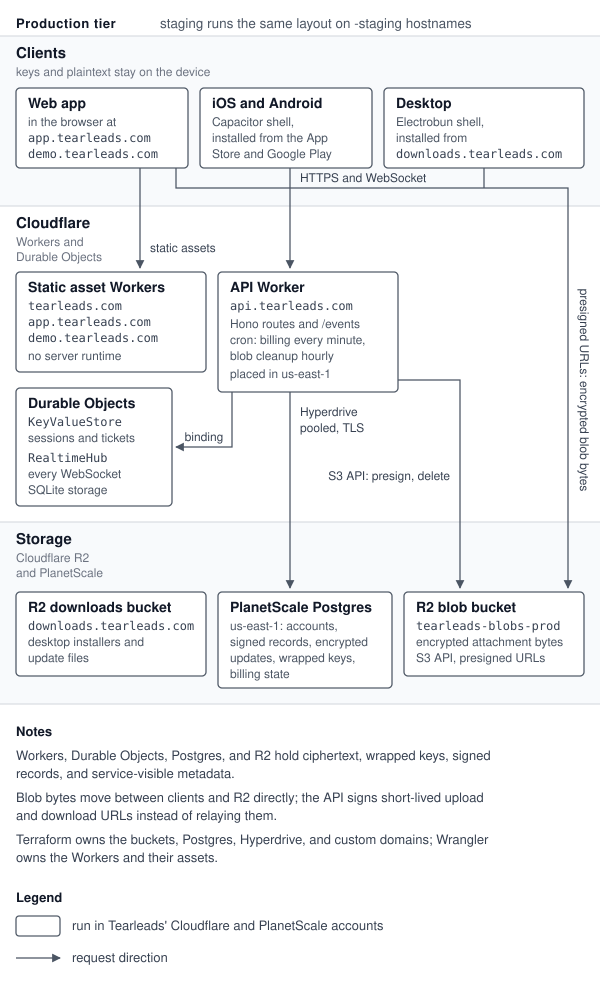
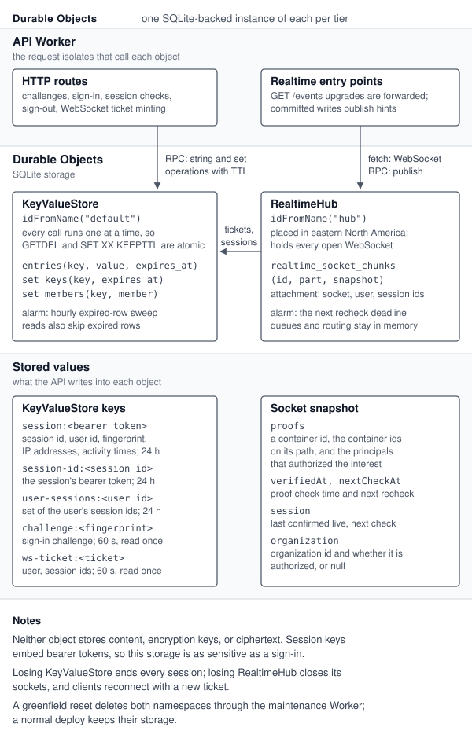

# Infrastructure and deployment

Deployment and release credentials live in `.secrets`, a gitignored link to
`../matrix-secrets/tearleads`. The a2f0/matrix repository manages and backs them
up; see its [`docs/secrets.md`](https://github.com/a2f0/matrix/blob/main/docs/secrets.md).
A clone that has none gets that link from
[`scripts/lib/secretsStore.sh`](../../scripts/lib/secretsStore.sh): beside the
clone, beside the matrix workspace for a `checkouts/<name>` checkout, or under
`MATRIX_SECRETS_DIR` when set. `load_secrets_env` in
[`terraform/scripts/secretsEnv.sh`](../../terraform/scripts/secretsEnv.sh),
which every deploy, destroy, Terraform stack, soft reset, and desktop release
calls, links first and stops with an error when the tier folder is still
missing. The native release shortcuts, App Store build-number lookup,
subscription review screenshots, LocalStack scripts, and Android and iOS dev
launchers link the same way, so LocalStack's `staging/dev.env` is shared by
every linked clone.
Each tier reads only `.secrets/staging/` or `.secrets/prod/`: `shared.env`, then
`app.env`, which wins. Commands without a tier use `prod`.

## Public Hostnames

Production uses `tearleads.com`, `app.tearleads.com`, `demo.tearleads.com`, and
`api.tearleads.com`. Staging uses `website-staging.tearleads.com`,
`app-staging.tearleads.com`, `demo-staging.tearleads.com`, and
`api-staging.tearleads.com`. The demo hosts serve the two-pane demo variant of
the same bundle. [Realtime events](realtime-hints.md) share each tier's API
hostname at `/events`.

Production web hosts are indexable, and the demo hosts' shell names the app root
as its canonical URL. Staging web hosts name no canonical URL and send
`X-Robots-Tag: noindex, nofollow` with a matching robots meta tag. The website
build adds these for `PUBLIC_ENVIRONMENT=staging` (see the
[website guide](../../packages/website/README.md#search-and-link-previews)).
[`packages/app-web/scripts/deployAppWeb.sh`](../../packages/app-web/scripts/deployAppWeb.sh)
builds the app with `APP_WEB_TIER`, which
[`scripts/injectTierMeta.ts`](../../packages/app-web/scripts/injectTierMeta.ts)
reads, then adds the header while staging the assets and refuses a build whose
tags do not match its tier.

Each app host serves `/.well-known/apple-app-site-association` as JSON, naming
the tier's iOS app (`com.tearleads.app`, or `com.tearleads.staging.app` on
staging) under the Apple team in the tier's `TEAM_ID`. iOS saves passwords to
iCloud Keychain for a host named in an app's `webcredentials:` entitlement
only when that host's file names the app. `TEAM_ID` must be the team that signs
the app, as the release lanes do by default, and the app-web deploy refuses to
start without a 10-character one.

Every proxied tearleads.com host, staging and continuity included, answers
`http://` with a 301 to `https://` before any Worker runs. That is the zone's
Always Use HTTPS setting, which the production website stack owns because it
is zone-wide. Every client, provider webhook, and billing return URL that
names a tearleads.com host uses `https://`.

### Website email delivery to Balebase

Google Workspace receives mail for `tearleads.com` and forwards each configured
recipient to its own Balebase address. The direct SMTP pilot uses the
`base.tearleads.com` subdomain. Create each binding in the production
**Tearleads** organization. All organization members can read these inboxes.

| Recipient | Balebase inbox | Delivery |
| --- | --- | --- |
| `legal@tearleads.com` | Legal | Google Workspace recipient mapping |
| `support@tearleads.com` | Support | Google Workspace recipient mapping |
| `legal@base.tearleads.com` | Legal pilot | Direct SMTP |
| `support@base.tearleads.com` | Support pilot | Direct SMTP |

#### Forward the website addresses

1. In Balebase, add `tearleads.com` as an inbound mail domain. Copy the
   complete TXT value beginning with `balebase-verification=`.
2. Save that value, without DNS quotation marks, as
   `TF_VAR_balebase_verification_txt` in the production tier's `app.env`.
   Keep the setting for subsequent deployments. Omitting it after enrollment
   stops the plan at the TXT record's destruction guard. The website stack
   manages the record at `_balebase-verification.tearleads.com` and needs
   DNS Edit permission for the zone. Review the saved plan in a private
   directory using the production stack wrapper.

   ```sh
   RUN_DIR="$(mktemp -d)"
   terraform/scripts/run-website-stack.sh prod plan -out="$RUN_DIR/website.tfplan"
   ```

   Confirm that the plan only adds the expected verification record. Apply
   that plan and check the DNS answer.

   ```sh
   terraform/scripts/run-website-stack.sh prod apply "$RUN_DIR/website.tfplan"
   dig +short TXT _balebase-verification.tearleads.com
   ```

3. When the DNS answer matches the issued value, verify the domain in
   Balebase. Bind each apex recipient in the table to its named inbox. Copy
   the separate forwarding address generated for each binding.
4. In the Google Admin console, open **Apps → Google Workspace → Gmail →
   Routing** for the top-level organizational unit. Under **Email forwarding
   using recipient address map**, map each exact apex address to its own
   copied destination. Keep the two mappings in separate rules so they can
   be changed independently. Confirm an original recipient can receive mail
   for each address before enabling dual delivery. Choose **All incoming
   messages** and **Also route to original destination** for each rule.
   [Google Workspace address mapping](https://support.google.com/a/answer/4524505)
5. From an external mailbox, send a distinct test message to each apex
   address. Check the original recipients and match each subject to the
   expected Balebase inbox in the table. After propagation, each rule can
   switch to Balebase-only delivery by clearing **Also route to original
   destination**. Repeat that recipient's delivery check after switching.
6. After confirming delivery to **Support**, set `PUBLIC_SUPPORT_EMAIL_ENABLED`
   to `true` in the production tier's `app.env` and publish the website. Check
   that the billing-help link on `/manage-subscription/` opens
   `support@tearleads.com`. The Privacy Policy and Terms of Service continue
   to link to `legal@tearleads.com`.

To restore Google's original delivery for one address, remove only its
recipient mapping and send a fresh test to the address. If withdrawing the
published Support address, first set `PUBLIC_SUPPORT_EMAIL_ENABLED=false` and
republish the website to restore the Legal billing-help link. Keep accepting
mail at the old Support address for people who saved it. The apex proof stays
published for the active bindings.

#### Direct delivery pilot on base.tearleads.com

The child MX sends mail directly to Balebase for both pilot recipients.
It leaves the apex Google routing in place.

1. In the production Tearleads organization in Balebase, add
   `base.tearleads.com` and copy its TXT value. Save that value separately
   as `TF_VAR_balebase_subdomain_verification_txt` in the production tier's
   `app.env`. Keep the apex setting. Set
   `TF_VAR_enable_balebase_subdomain_mx=false`. With a child challenge set,
   each deployment requires an explicit MX setting.
2. Use the production website stack plan and apply steps above. Confirm the
   plan adds the child TXT record before applying. Check its public answer
   with `dig +short TXT _balebase-verification.base.tearleads.com`, then
   verify the subdomain in Balebase. Bind both exact pilot addresses to their
   respective named inboxes in the table. Keep the child TXT published while
   either pilot inbox is active because Balebase rechecks domain ownership.
3. Before activating MX, query the authoritative servers and compare each
   TXT answer to the issued child challenge. From a host that can reach
   outbound TCP port 25, check that the Balebase receiver presents a valid
   TLS certificate and accepts both bound pilot addresses. The SMTP check
   ends after the recipient commands and sends no message.

   ```sh
   for ns in $(dig +short NS tearleads.com); do
     dig +short @"$ns" TXT _balebase-verification.base.tearleads.com
   done

   python3 - <<'PYTHON'
   import smtplib
   import ssl

   with smtplib.SMTP("mx.balebase.com", 25, timeout=15) as smtp:
       smtp.ehlo()
       smtp.starttls(context=ssl.create_default_context())
       smtp.ehlo()
       code, detail = smtp.mail("")
       if code != 250:
           raise SystemExit(f"MAIL FROM failed: {code} {detail!r}")
       for recipient in ("legal@base.tearleads.com", "support@base.tearleads.com"):
           code, detail = smtp.rcpt(recipient)
           if code not in (250, 251):
               raise SystemExit(f"{recipient}: RCPT TO failed: {code} {detail!r}")
           print(f"Balebase accepts {recipient}")
   PYTHON
   ```

4. After both checks pass, set `TF_VAR_enable_balebase_subdomain_mx=true`.
   Plan again. Confirm the only change is an MX at `base.tearleads.com` with
   priority 10 and destination `mx.balebase.com`. Apply that saved plan.
5. Check `dig +short MX base.tearleads.com` for `10 mx.balebase.com.`
   and `dig +short MX tearleads.com` for the Google hosts. From an external
   mailbox, send a different subject to each of the four addresses in the
   table. Check that each subject arrives in its expected inbox.

To retire a single pilot address, direct its senders to the corresponding
apex address and verify delivery there. Once mail in transit has arrived,
disconnect only that pilot binding in Balebase. Confirm the other pilot
address still receives an external test message.

To withdraw the entire pilot, direct both sets of senders to their apex
addresses, then set `TF_VAR_enable_balebase_subdomain_mx=false`. Keep both
TXT settings and both Google mappings. Plan and apply removal of only the
child MX, check the child and apex MX answers, and retest both apex addresses.
Keep the pilot bindings available for cached MX records and mail in transit.

### The www Redirect

`www.tearleads.com` answers 301 to `https://tearleads.com`, keeping the path
and query, over both `http://` and `https://`. It runs before any Worker and is
managed outside Terraform: the deployment token lacks Zone → Single Redirect →
Edit ("Dynamic URL Redirects Write"), so it was created on 2026-10-24 with the
`cf` CLI under the account owner's login. Two zone objects make it up:

- the zone's `http_request_dynamic_redirect` entry point ruleset, `Redirects`
  (`f1ae7d2dd8e54b9485a5b5a3e94c0e55`), with one rule, ref `www_to_apex`;
- a proxied `AAAA` record `www.tearleads.com` → `100::`
  (`ea96222c9711296a4f4440e278aed4f0`), which gives the name an edge address
  for the rule to answer.

To recreate it, put the rule in `rules.json`:

```json
[
  {
    "ref": "www_to_apex",
    "description": "www.tearleads.com to tearleads.com",
    "expression": "(http.host eq \"www.tearleads.com\")",
    "action": "redirect",
    "action_parameters": {
      "from_value": {
        "status_code": 301,
        "preserve_query_string": true,
        "target_url": {
          "expression": "concat(\"https://tearleads.com\", http.request.uri.path)"
        }
      }
    }
  }
]
```

Then run:

```sh
cf rulesets entrypoint update http_request_dynamic_redirect -z tearleads.com \
  --name Redirects --rules @rules.json
cf dns records create -z tearleads.com \
  --body '{"type":"AAAA","name":"www.tearleads.com","content":"100::","proxied":true,"ttl":1,"comment":"Redirected to the apex by the Redirects ruleset (managed with cf)"}'
```

A zone has one entry point ruleset per phase. Once the token gains that
permission, a Terraform-managed redirect must import this ruleset and the
record, not create new ones. Check it live with:

```sh
curl -sI https://www.tearleads.com/ | grep -i '^location'
```

## Infrastructure Lifecycle



The [infrastructure diagram](../diagrams/infrastructure.svg), also Fig. 5 on
the website's /security page, shows one tier's clients, Workers, and storage.



The [Durable Objects diagram](../diagrams/durable-objects.svg), Fig. 6 on
/security, breaks out the API's two Durable Objects: the SQLite tables each
one keeps and the keys and socket state the API writes into them.

Terraform provisions each tier's persistent resources and Wrangler publishes
its Workers. Neither migrates deployment names or Terraform resource
addresses: retire a resource through its owning configuration and state before
provisioning its replacement. Preserve any needed data offline, and never
discard state for live resources or point a populated stack at an empty
backend.

Each tier is four Cloudflare Workers plus independent Terraform stacks:

- [`packages/api`](../../packages/api/) deploys `tearleads-platform-api-<tier>`:
  the Hono API, two SQLite Durable Objects (`KeyValueStore`, which holds
  sessions and tickets, and `RealtimeHub`, which owns every WebSocket), and the
  Cron Triggers that run
  [blob garbage collection](../attachment-retention.md#operations) hourly and
  [billing maintenance](revenuecat-billing.md#billing-maintenance-worker)
  every minute. A placement hint keeps it near PlanetScale Postgres in
  `us-east-1`, because registration performs many sequential database queries
  inside one transaction and cross-region round trips exceed Cloudflare's
  response timeout even though the write commits.
- [`packages/app-web`](../../packages/app-web/) deploys `tearleads-app-<tier>`
  and `tearleads-demo-<tier>` as Workers Static Assets, and
  [`packages/website`](../../packages/website/) deploys the marketing site.
- `terraform/stacks/<tier>/postgres` owns the tier's PlanetScale Postgres and
  Hyperdrive configuration, `terraform/stacks/<tier>/storage` its R2 blob
  bucket and API credentials, and `terraform/stacks/<tier>/edge` the custom
  domains that attach the API, app, and demo hostnames to the published
  Workers. `terraform/stacks/<tier>/downloads` owns the public desktop release
  bucket at `downloads.<domain>` or `downloads-staging.<domain>`, which desktop
  release publication fills. `terraform/stacks/<tier>/website` holds the
  website's domain; production's also turns on the zone's Always Use HTTPS,
  which needs Zone Settings Edit on its token. The provider's destroy only
  forgets that setting, so a teardown leaves it on. Production also has a
  `continuity` stack for the `continuity.<domain>` site, whose assets the
  a2f0/continuity repository publishes.

Every stack keeps its state in the Cloudflare R2 bucket
`tearleads-terraform-state`, at `<tier>/<stack>/terraform.tfstate`, through the
S3 backend with lockfile locking. The bucket was created by hand and no stack
manages it. The `run-*-stack.sh` wrappers in
[`terraform/scripts/`](../../terraform/scripts/) hand Terraform the
tier's `TF_STATE_ACCESS_KEY_ID` and `TF_STATE_SECRET_ACCESS_KEY` from
`.secrets/<tier>/app.env` as `AWS_ACCESS_KEY_ID` and `AWS_SECRET_ACCESS_KEY`,
ignoring any AWS profile or session. That pair is the R2 S3 key of a token
limited to the state bucket: the token ID and the SHA-256 of the token value. No
stack uses the AWS provider.

[`scripts/deploy/deployStaging.sh`](../../scripts/deploy/deployStaging.sh) and
[`scripts/deploy/deployProduction.sh`](../../scripts/deploy/deployProduction.sh)
run the whole sequence: storage, database, API migrations and Worker, app
bundles, edge hostnames (which need the Workers to exist), API verification,
then website. Staging applies its storage and Postgres stacks on every full
deploy; production only checks that they are already provisioned.
`--skip-terraform` skips every Terraform apply.
[`packages/api/scripts/deployApi.sh`](../../packages/api/scripts/deployApi.sh)
migrates with the PlanetScale migration login, syncs the Worker secrets from the
Terraform outputs and the `.secrets/<tier>/` env files, and publishes with the
build constants from
[`packages/api/scripts/workerDefines.ts`](../../packages/api/scripts/workerDefines.ts).
The document sync cursor HMAC key and `TWO_FACTOR_SECRET_KEY` are generated
once per tier into `.secrets/<tier>/worker.env`. The two-factor key seals
authenticator secrets and keys recovery-code hashes, so never rotate it on a
live tier: every enrolled user would be left unable to answer a second factor.
A reset that wipes the database may rotate it.

Neither tier deployment applies the downloads stack. After a teardown, apply it
from a saved plan before publishing a desktop release. The wrapper runs
Terraform without input, so it cannot approve an apply without a plan file.
With `TIER` set to `staging` or `prod` and `RUN_DIR` a private directory:

```sh
terraform/scripts/run-downloads-stack.sh "$TIER" plan -out="$RUN_DIR/downloads.tfplan"
terraform/scripts/run-downloads-stack.sh "$TIER" apply "$RUN_DIR/downloads.tfplan"
```

[`scripts/deploy/destroyStaging.sh`](../../scripts/deploy/destroyStaging.sh) and
[`scripts/deploy/destroyProduction.sh`](../../scripts/deploy/destroyProduction.sh)
remove every resource of their tier, including the downloads bucket and the
website, through
[`scripts/deploy/destroyTier.sh`](../../scripts/deploy/destroyTier.sh), timing
each step. The production script asks for the domain unless given
`--auto-approve`; the production teardown steps refuse to run outside it. The
stack wrappers refuse a production `destroy`; the teardown applies saved destroy
plans. Before tearing down an enrolled production website, restore and verify
delivery to the original mailboxes using the [website email
procedure](#website-email-delivery-to-balebase) and withdraw any active
subdomain pilot. The authorized teardown removes the verification records.

The deployed API allows browser requests from every origin (`API_CORS_ORIGINS=*`)
for [SDK hosts](sdk-hosting.md), with explicit bearer-token and protocol headers
and no cookie credentials. [Stripe checkout](stripe-checkout-client.md) and
portal return URLs use the independent
`API_BILLING_RETURN_ORIGINS` allowlist. Deployments derive it from the tier's app
and demo hosts plus native loopback origins; a tier setting replaces that list.
Wildcards are rejected for billing. Local servers default to unrestricted CORS
and no billing return origins; configure the billing list to use hosted checkout.

The Worker connects through its `HYPERDRIVE` binding. The Postgres stack
configures Hyperdrive with the runtime login, PlanetScale's pooled port 6432,
TLS with WebPKI certificate validation, and query caching disabled. Fresh reads
are required for sync cursors,
[access epochs](../glossary/access.md#access-epoch), and session revocation. The
Cloudflare deployment token needs Hyperdrive Edit.

The API deploy reads `hyperdrive_id` from Terraform and fills the selected
environment's binding in a temporary Wrangler configuration beside
[`packages/api/wrangler.jsonc`](../../packages/api/wrangler.jsonc), removed on
exit. After publishing, it deletes any Worker secret the deploy does not manage,
so an integration disabled in the tier's env file stays disabled. Only the
deploy host receives the migration login, which connects directly on port 5432.
Run the tier deployment scripts to resolve the binding; a bare `wrangler deploy`
has no configuration ID.

`POSTGRES_REQUEST_SCOPED` gives each request its own
[pool](../limits.md#database-connections) of up to four connections
(`POSTGRES_POOL_MAX`): Workers cannot share sockets across requests, even
through Hyperdrive. The pool closes when the request finishes; Hyperdrive
retains the origin connections. Transient acquisition failures retry once before
any SQL runs; an exhausted connection or checkout timeout returns HTTP 503. The
pool never retries queries or transaction callbacks after acquisition. Sentry
records the acquisition stage, attempt count, and bounded pool counters; see
[API diagnostics](api-sentry.md). The 30 s idle timeout allows reuse during a
long request. `POSTGRES_COALESCE_WRITES` gathers each query's protocol messages
into one socket write. `POSTGRES_POOL_MAX_USES=1` applies only to work outside
an event scope, whose sockets must not survive a checkout. The realtime hub also
scopes its HTTP, RPC, WebSocket, and alarm events, closing their pools before it
can hibernate. See
[realtime hub hibernation](realtime-hints.md#cloudflare-hub-hibernation). The
`local` Wrangler environment keeps the direct Postgres transport for workerd
tests. Deployed environments require Hyperdrive.

Keep the `aws:us-east-1` placement hint until measurements from multiple client
regions justify Smart Placement. Hyperdrive removes connection setup costs, but
registration issues many sequential queries, so its latency depends on
placement. Smart Placement needs sustained traffic from multiple
locations to learn a placement; a single deployment smoke cannot establish it.
