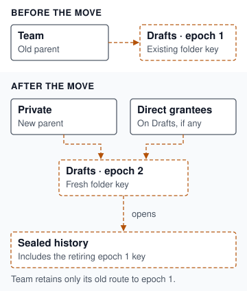
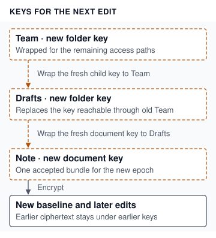

# How re-keying works

A folder has a **key-encryption key** (KEK). A document has a **data-encryption
key** (DEK) that encrypts its contents. Each folder the document is linked to
has a wrapped copy of the DEK. A *wrap* encrypts one key for a particular
recipient. An *epoch* identifies a generation of a key.

## Sharing a folder

Suppose Alice shares a folder with Ben. Her client signs the new access
manifest, which records who has access, and adds a wrap of the existing folder
key for Ben. The folder keeps its key epoch. Its children, documents, and
attachment bytes need no changes. Ben can use the current key to open the
folder's sealed keyring and recover keys for retained history.

## Moving a folder

Suppose Alice moves **Drafts** from **Team** to **Private** within the same
organization. Ben's only access was through Team. Alice needs admin access to
Drafts and write access to Private. Her client verifies both folder paths,
generates a fresh 32-byte key for Drafts, and signs a move that binds Drafts
to Private. A change of parent creates a new key epoch even when the same
people can access both parents.

The client wraps the new Drafts key for Private and for the direct grants on
Drafts. A direct grant to Ben on Drafts would therefore survive the move. In
this example he had only inherited access, so Team's key can still open the
old Drafts key but gives him no route to the new one.

The move also seals the previous Drafts key under its successor (a
*predecessor bridge*) and seals all earlier Drafts keys together under the
new key (the *keyring*). Someone admitted through Private can read retained
history. Ben can keep any old key, ciphertext, or plaintext he already had.
[Folder move implementation](../packages/client-sdk/src/workflows/containers/child/move/index.ts)

## Revoking access and writing below a changed folder

Removing a direct grant rotates the affected folder key. As with a move, the
new key goes to the current parent, if any, and the remaining direct
recipients. A person with a separate valid access path can still use it.

Suppose Ben loses his only grant to **Team**, and **Drafts** is an unshared
child of Team. A retained writer can still read the old note in Drafts.
Before accepting another edit, the protocol requires a current chain of keys
all the way from Team to the note.

The client repairs stale folders parent-first. Some repairs must travel with
the original rotation so that someone with a direct grant deeper in the tree
can still write independently. Other branches, like unshared Drafts, can wait
until the next write touches them. The API checks the signed changes and
exact key targets. Clients generate keys and create the wraps.
[Descendant repair rules and limits](keying-design/content-keys.md)

## Document moves, attachments, and offline edits

- **Linking a document to another folder** adds a target. The same DEK can be
  wrapped for the expanded set of folders.
- **Moving a document** links it to the destination, then unlinks it from
  the source. Unlinking rotates the DEK. The client wraps the new key for the
  remaining folders and submits the document's history again, encrypted under
  the new key (the *baseline*), with the unlink. A document with no committed
  updates can skip the baseline. Later edits use the new DEK. Older updates
  keep their keys.
- **An existing attachment** has immutable encrypted bytes and a separate
  wrapped content key. Its wraps can change as its active bindings change.
  Changing the key that encrypted the bytes requires replacing or
  re-encrypting the attachment.
- **A writer who was offline** verifies current access on return. If another
  device already established the new baseline, the writer adopts the accepted
  key bundle and can re-emit pending edits from local document state. If a
  linked folder still needs repair by someone with access there, edits can
  wait. A writer who lost all write paths cannot submit new edits.

For the protocol details, see the [container key hierarchy](keying-design/container-keks.md),
[document and blob keys](keying-design/content-keys.md), and
[document re-keying and audit history](document-rekey-and-audit-history.md).
